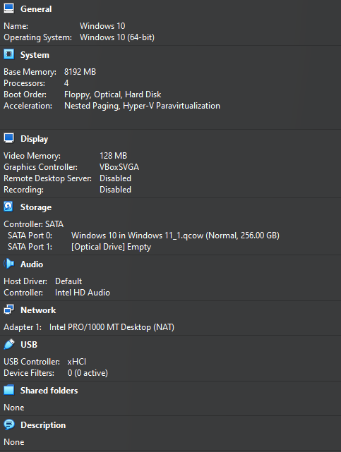

# Windows-10-in-VirtualBox
| Specs | How Much? |   
| -------- | -----------|   
| Hard Drive | 256 GB (11 GB Used) |   
| Ram | 8 GB|   
| CPU cores | 4 |   
| Video Memory | 128 MB|   

This does not come pre activated you will need to bring you own key for full use   
I used .qcow for the virtual hard drive for compatibility with other vm apps   
Default login credentals   
Username: User   
Password: 1234   

